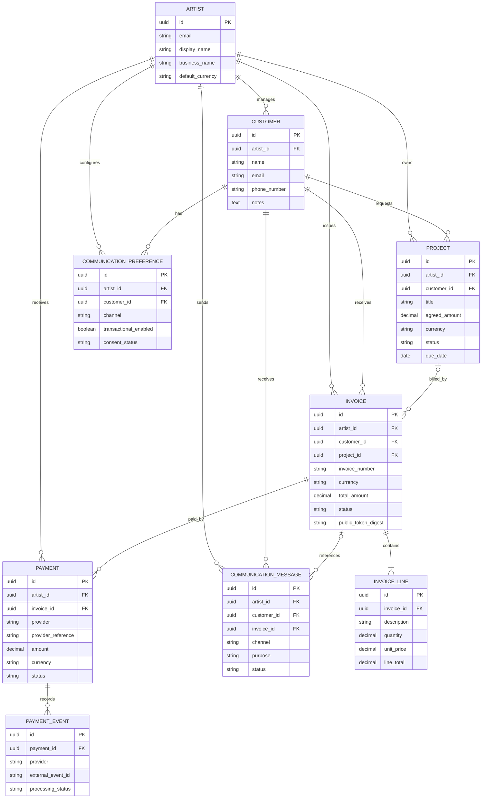
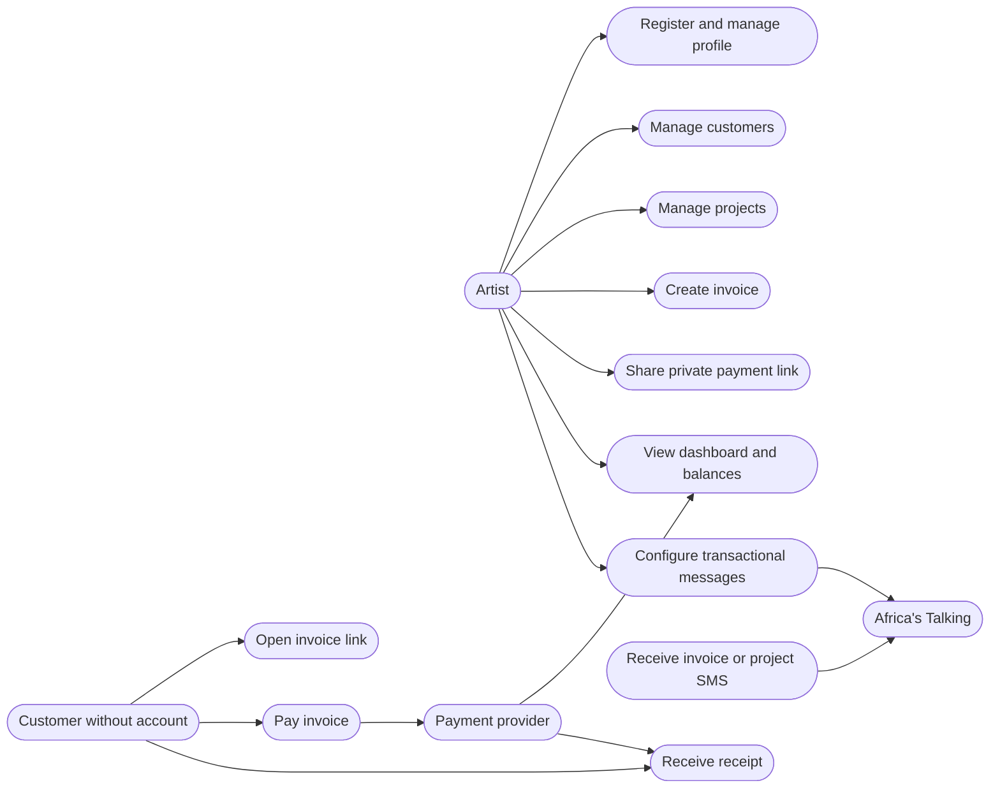

# ERD and User UML

This document explains entity relationships and user-facing use cases. Keep it aligned with `schema.md`.

## 1. Entity relationship diagram

### Relationship notes

- An artist manages many customers and owns many projects, invoices, payments, and communication records.
- A customer can have many projects and invoices. A customer record is scoped to one artist in the MVP.
- A project belongs to one artist and one customer. It may have zero or more invoices.
- An invoice belongs to one artist and one customer, and may optionally relate to a project.
- An invoice contains one or more line items after it is issued.
- An invoice can have multiple payment attempts/records to support deposits and instalments.
- A payment can have multiple provider events. The provider event identity must be deduplicated where the provider supplies stable IDs.
- Communication preferences and messages are tied to the artist-customer relationship. A failed SMS does not alter payment status.
- Enforce same-artist relationships. A foreign key alone does not automatically guarantee that the referenced customer and invoice share the same artist.

## 2. Artist use-case UML

## 3. Role-based workflow summary

### Artist
- Authenticated access to own dashboard and records.
- Create/edit customers, projects, invoices, and supported payment requests.
- View payment reconciliation and communication status.
- Revoke private links where supported.
- Never access another artist's private records.

### Customer
- No platform account required.
- Access only the invoice data exposed by a valid private token.
- Initiate payment through the supported provider flow.
- View confirmation/receipt for their transaction.
- Cannot access artist dashboard, other invoices, or internal notes.

### External providers
- Payment provider processes the payment and provides verified server-side evidence.
- Africa's Talking sends communication through the supported API.
- Provider acceptance is not equivalent to confirmed payment or guaranteed SMS delivery.

## 4. Consistency checks

Whenever the data model changes:
1. Update `schema.md`.
2. Update the ERD and relationship notes here.
3. Update `API.md` if exposed behaviour changes.
4. Add/update migration and tests.
5. Record significant trade-offs in `research.md`.
